# Task-2: FastAPI guestbook with MySQL, PV/PVC, ConfigMap, Secret and Ingress

A FastAPI guestbook app with one MySQL server that reads and writes:

- MySQL keeps its data on a PV + PVC
- The app settings are in a ConfigMap, and the MySQL credentials are in a Secret
- Users reach the app through an Ingress

The app (`webapp/`) and the MySQL image (`mysql/`) were provided. I built them and did not change them. The cluster is the 3-node minikube cluster from Task 1.

## Files

| File | Content |
|---|---|
| `01-namespace.yaml` | Namespace `webapp-stack` |
| `02-secret.yaml` | Secret `mysql-secret` |
| `03-configmap.yaml` | ConfigMap `webapp-config` |
| `04-pv-pvc.yaml` | PV `mysql-pv` and PVC `mysql-pvc` |
| `05-mysql.yaml` | MySQL Deployment and Service |
| `06-webapp-api.yaml` | App Deployment and Service |
| `07-ingress.yaml` | Ingress `webapp-ingress` |

---

## 1. Build the images and load them into minikube

Minikube runs its own Docker inside the nodes, so it cannot see images built on my machine. I built both images and loaded them into the cluster. The Deployments use `imagePullPolicy: IfNotPresent`, so Kubernetes does not try to download them.

```bash
minikube start
kubectl get nodes
chmod -x mysql/initdb/01-setup.sh
docker build -t webapp-api:task2 ./webapp
docker build -t webapp-mysql:task2 ./mysql
minikube image load webapp-api:task2
minikube image load webapp-mysql:task2
minikube image ls | grep task2
```

The 3 nodes are `Ready` and both images (`webapp-api:task2`, `webapp-mysql:task2`) are listed.

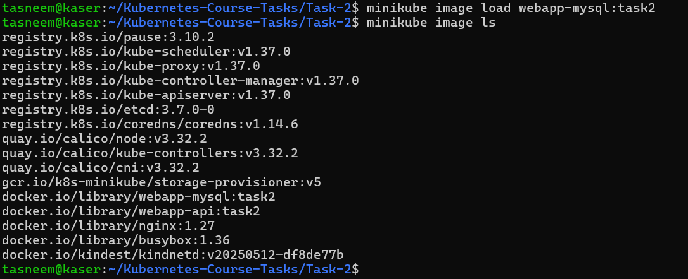

---

## 2. Namespace, Secret and ConfigMap

The namespace `webapp-stack` holds every object of this task, except the PV (a PV has no namespace).

The **Secret** `mysql-secret` stores the sensitive values, written with `stringData`:

| Key | Value |
|---|---|
| `root-password` | `rootpass123` |
| `app-user` | `webapp` |
| `app-password` | `webapp123` |

The **ConfigMap** `webapp-config` stores the non-secret settings: `APP_TITLE`, `APP_ENV`, `MYSQL_HOST` (the MySQL Service name), `MYSQL_PORT` and `MYSQL_DATABASE`.

```bash
kubectl apply -f 01-namespace.yaml
kubectl apply -f 02-secret.yaml
kubectl apply -f 03-configmap.yaml
kubectl get ns webapp-stack
kubectl get secret mysql-secret -n webapp-stack
kubectl get configmap webapp-config -n webapp-stack
```

The namespace is `Active`, the Secret has DATA 3 and the ConfigMap has DATA 5.

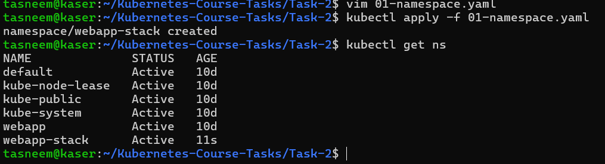
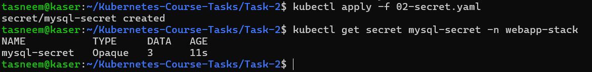
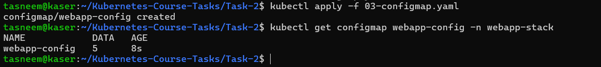

---

## 3. PV and PVC

- `mysql-pv` is a 2Gi `hostPath` volume at `/data/webapp-mysql`, with `storageClassName: manual` and the `Retain` policy.
- `mysql-pvc` is a 2Gi claim in `webapp-stack` that binds to `mysql-pv`.
- `nodeAffinity` pins the PV to the worker `minikube-m02`. A `hostPath` folder exists on one node only, so without it the MySQL Pod could start on another node after a restart and lose its data.

```bash
kubectl get nodes -L kubernetes.io/hostname
kubectl apply -f 04-pv-pvc.yaml
kubectl get pv mysql-pv
kubectl get pvc mysql-pvc -n webapp-stack
```

Both are `Bound`, `2Gi`, and the PV claim is `webapp-stack/mysql-pvc`.

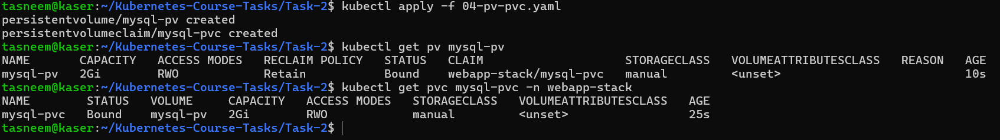

---

## 4. MySQL Deployment and Service

- 1 replica with `strategy: Recreate`, so two MySQL servers never use the same data folder
- Image `webapp-mysql:task2`
- `MYSQL_ROOT_PASSWORD`, `APP_DB_USER` and `APP_DB_PASSWORD` come from the Secret (`secretKeyRef`)
- `APP_DB_NAME` comes from the ConfigMap key `MYSQL_DATABASE` (`configMapKeyRef`)
- `mysql-pvc` is mounted at `/var/lib/mysql`
- readiness and liveness probes use `mysqladmin ping -h 127.0.0.1`, and the liveness probe waits 60 seconds because the first start creates the database
- Service `mysql`: ClusterIP on port 3306

```bash
kubectl apply -f 05-mysql.yaml
kubectl get pods -n webapp-stack -w
kubectl logs deploy/mysql -n webapp-stack | tail -5
kubectl get endpoints mysql -n webapp-stack
kubectl get pods -n webapp-stack -l app=mysql -o wide
```

The MySQL Pod is `1/1 Running` on `minikube-m02`, the log shows "ready for connections", and the Service has 1 endpoint on port 3306.

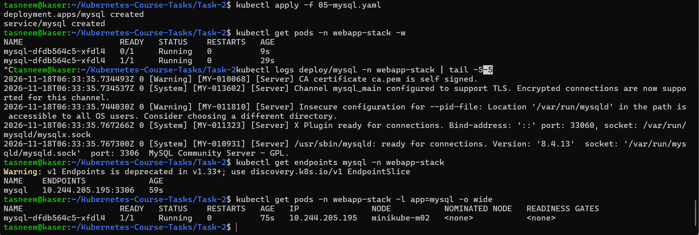

---

## 5. App Deployment and Service

- 2 replicas of `webapp-api:task2` on port 8000
- all ConfigMap keys are passed with `envFrom`
- `MYSQL_USER` and `MYSQL_PASSWORD` come from the Secret
- readiness and liveness probes call `GET /health` on port 8000
- Service `webapp-api`: ClusterIP, port 80 to 8000
- `MYSQL_PORT` is kept in the ConfigMap because Kubernetes would otherwise inject `MYSQL_PORT=tcp://<ip>:3306` for the Service `mysql`, which the app cannot use

```bash
kubectl apply -f 06-webapp-api.yaml
kubectl get pods -n webapp-stack -w
kubectl exec -n webapp-stack deploy/webapp-api -- env | grep -E "APP_|MYSQL_"
kubectl get endpoints webapp-api -n webapp-stack
```

Both app Pods are `1/1 Running`, the environment variables are present, and the Service has 2 endpoints on port 8000.

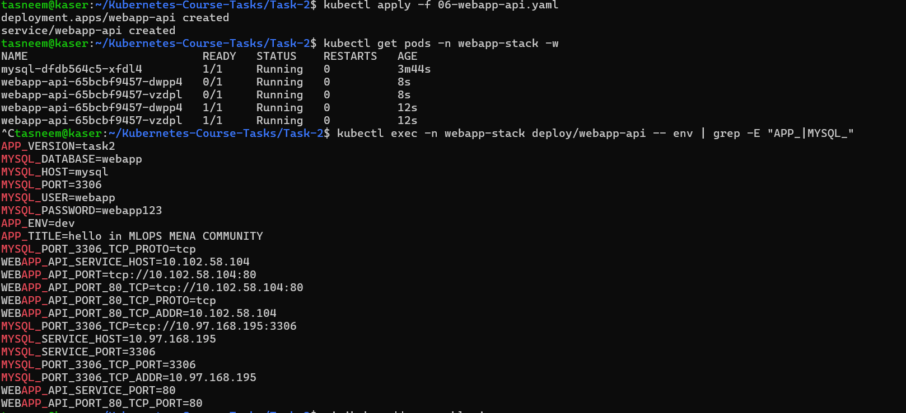

---

## 6. Ingress Controller and Ingress

An Ingress is only a set of routing rules, so a controller (nginx) is needed to apply them. I used the minikube addon.

```bash
minikube addons enable ingress
kubectl get pods -n ingress-nginx
kubectl get ingressclass
```

The controller Pod is `Running` and the ingress class is `nginx`.

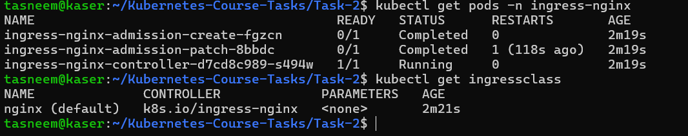

Then I created the Ingress `webapp-ingress` (class `nginx`, path `/`, `Prefix`, to the Service `webapp-api` port 80):

```bash
kubectl apply -f 07-ingress.yaml
kubectl get ingress webapp-ingress -n webapp-stack
```

The class is `nginx` and the ADDRESS is filled.


---

## 7. Open the app

```bash
kubectl port-forward -n ingress-nginx svc/ingress-nginx-controller 8080:80
```

I opened `http://localhost:8080` in the browser.

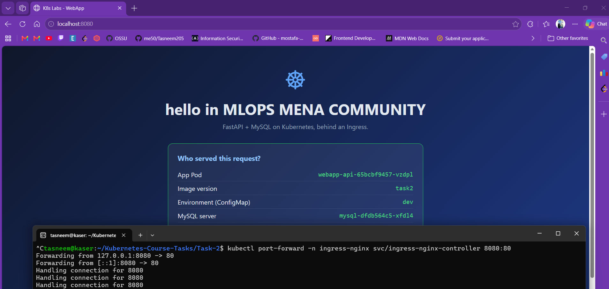

---

## 8. Verification

```bash
kubectl get deploy -n webapp-stack
kubectl exec -n webapp-stack deploy/mysql -- sh -c 'mysql -uroot -p"$MYSQL_ROOT_PASSWORD" -e "SELECT * FROM webapp.messages"'
curl http://localhost:8080/api/info
curl -X POST http://localhost:8080/api/messages -H "Content-Type: application/json" -d '{"author":"student","content":"hello"}'
curl http://localhost:8080/api/messages
```

Results:

- `mysql` is `1/1` and `webapp-api` is `2/2`
- the table has the 2 default messages
- `/api/info` shows `"version": "task2"`, the title `hello in MLOPS MENA COMMUNITY`, and environment `dev`
- the POST returns the new message id and the MySQL Pod that wrote it
- the GET shows my message and the 2 default ones

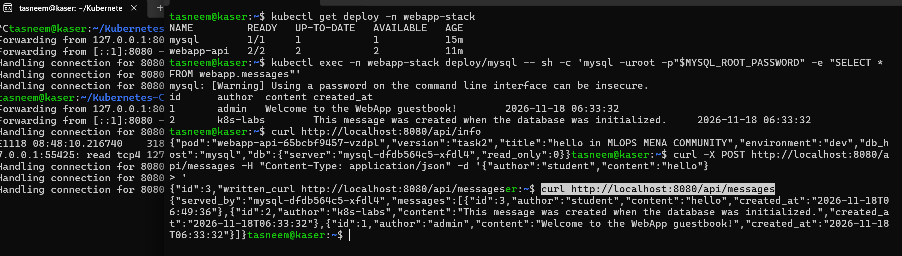

### Data survives a restart

I deleted the MySQL Pod and waited for the new one:

```bash
kubectl delete pod -n webapp-stack -l app=mysql
kubectl get pods -n webapp-stack -l app=mysql -o wide
curl http://localhost:8080/api/messages
```

The new Pod started on `minikube-m02` again (because of the `nodeAffinity`), and my message is still there. The data is stored on the PV, not in the Pod.

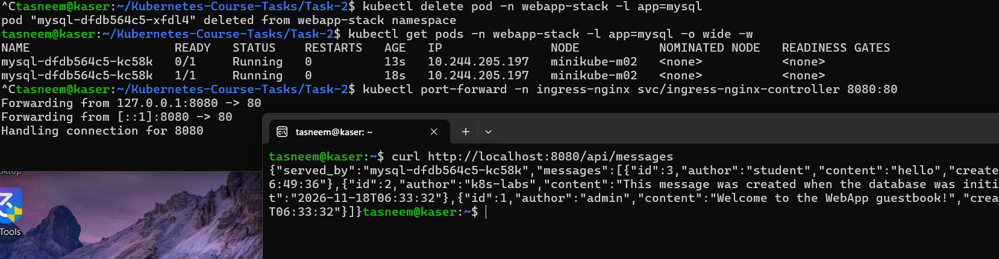